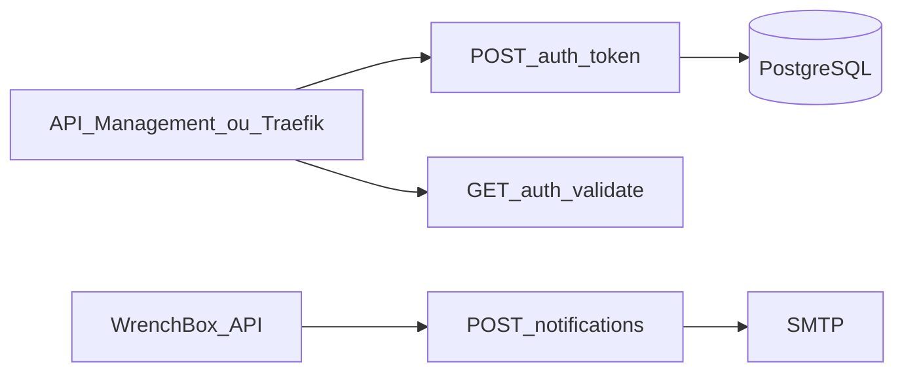

# WrenchBox Serverless

Função que autentica o cliente pelo CPF e a função que envia as notificações da ordem de serviço. É o repositório equivalente ao item "Lambda" do enunciado, executado como Azure Functions isoladas em .NET 8.

## Tecnologias

- .NET 8 e Azure Functions Worker isolado
- Npgsql para a leitura do cliente
- `System.IdentityModel.Tokens.Jwt` para o JWT
- MailKit para o SMTP
- Terraform `azurerm` para o Function App
- GitHub Actions com OIDC

## Arquitetura deste repositório



`POST /auth/token` valida o CPF, consulta `customers` e, se o status é Ativo, devolve um JWT sem o CPF. Falha responde `Não foi possível autenticar.` O motivo fica no log (`AuthDenied`).

`GET /auth/validate?role=Customer` é o forward-auth do Traefik local. Não deve ser publicado no gateway.

`POST /notifications/work-orders` exige a chave da função e envia o e-mail do evento que a API publica.

## Execução local

```bash
cp src/WrenchBox.Functions/local.settings.json.example src/WrenchBox.Functions/local.settings.json
dotnet test
func start --csharp
```

A collection e o Swagger da API estão no repositório da aplicação: `docs/WrenchBox.postman_collection.json` e `/swagger`. A rota de CPF entra pelo gateway em `/auth/token`.

## Deploy

1. O repositório do banco precisa existir antes (`rg-wrenchbox` e o Key Vault).
2. `terraform -chdir=infra init` e `terraform -chdir=infra apply -var key_vault_name=...`
3. Copie os outputs `function_names` para as variáveis `FUNCTION_APP_HOMOLOG` e `FUNCTION_APP_PROD`.
4. Push em `homolog` publica na função de homologação. Push em `main` publica em produção. As duas branches ficam protegidas e só recebem merge por pull request.

Segredos do workflow: `AZURE_CLIENT_ID`, `AZURE_TENANT_ID`, `AZURE_SUBSCRIPTION_ID`.

Dockerfile: imagem oficial `mcr.microsoft.com/azure-functions/dotnet-isolated:4-dotnet-isolated8.0`, usada pelo Compose de demonstração.
